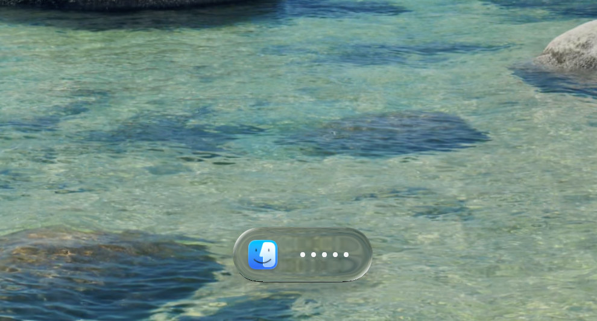

<h1 align="center">LiquidType</h1>

<p align="center">A native Mac AI voice typing tool with a <b>Liquid Glass</b> style.</p>

<p align="center"><a href="README.zh.md">中文说明</a></p>

<p align="center"></p>

**Waveform mode** — just the bars:

https://github.com/user-attachments/assets/76607c91-3a24-44b4-87d9-a04542938314

**Text mode** — see the transcript as you speak:

https://github.com/user-attachments/assets/35b473eb-5f48-4b00-8fda-0aef27471312

## What's different

* The UI is built with Liquid Glass on macOS 26, trying to stay as close to the real liquid glass material as possible.
* While you talk, you can see the recognized text in real time.
* If you'd rather not watch the words, you can switch it to a simple waveform.

## Note

The Liquid Glass effect currently uses `_variant: 11` (frosted). Only tested on macOS 26.0 Beta (Tahoe) — other versions may not produce the same result.

## Setup

You need **macOS 26** for the Liquid Glass effect.

The download is built for **Apple Silicon** (M1 and later). It probably won't run on Intel Macs — if you're on Intel, try building from source instead.

### Download

<a href="https://github.com/LuliYanng/LiquidType/releases/latest/download/LiquidType.dmg"></a>

Once downloaded, open the `.dmg` and drag **LiquidType** into **Applications**.

> [!IMPORTANT]
> I don't have a paid Apple Developer account, so the app isn't notarized. On first launch macOS will say it *can't verify LiquidType is free of malware*. That's expected.
>
> You need to let it through once per downloaded version. Pick one of the two ways below.

#### Recommended: Terminal

One command, works every time:

```bash
xattr -dr com.apple.quarantine /Applications/LiquidType.app
```

Then open LiquidType normally.

#### Or: System Settings

> [!NOTE]
> This needs an admin account. If it doesn't work, use the Terminal command above.

1. Open LiquidType — you'll get the warning. Click **Done**.
2. Go to **System Settings → Privacy & Security**.
3. Scroll to the bottom and click **Open Anyway** next to the LiquidType message.
4. Confirm with your password or Touch ID.

### Build from source

You'll need Xcode Command Line Tools.

```bash
git clone https://github.com/LuliYanng/LiquidType.git
cd LiquidType
bash scripts/install_app.sh
```

### First launch

On first launch, go to:

**System Settings → Privacy & Security**

Grant LiquidType two permissions, then relaunch:

1. **Accessibility**: so it can listen for the `fn` key and type into the current app.
2. **Microphone**: for recording.

Also turn off the system function for `fn`:

**System Settings → Keyboard → *Press fn key* → Do Nothing**

Last step — add an API key.

Click the menu bar icon → click **DashScope** → paste your API key → hit Return.

### API Keys

| Key                  | What it's for                          | Get one |
| -------------------- | -------------------------------------- | ------- |
| `DASHSCOPE_API_KEY`  | Qwen speech recognition + cleanup      | [Qwen platform](https://platform.qianwenai.com/home/api-keys) |
| `OPENROUTER_API_KEY` | Claude Haiku cleanup, optional         | [OpenRouter](https://openrouter.ai/settings/keys) |
| `CARTESIA_API_KEY`   | Cartesia English recognition, optional | [Cartesia](https://play.cartesia.ai/keys) |
| `TYPESAFE_API_KEY`   | Jev fast path (beta), optional         | [TypeSafe](https://console.typesafe.ai/keys) |

You only need `DASHSCOPE_API_KEY` to get started. Keys from any Model Studio region work (China, International, US) — the app figures out which one on its own.

## Usage

Pretty simple:

* Tap `fn` to start talking.
* Tap `fn` again to finish — the text gets typed into your current app.
* Press `esc` while recording to cancel.
* Click the menu bar icon → **Panel** to switch between text / waveform, change the speech model or cleanup LLM, and manage API keys.

### Dictionary

Speech recognition often gets names and jargon wrong. Add them under **Dictionary** in the panel and they'll come out right next time. Or turn on **Learn from my edits**: when you fix a misheard name by hand after LiquidType types it, the corrected word is added for you. A small notice shows what it learned; click ↺ on it to undo, and that word won't be learned again.

Learning is off by default. It reads back the text field you typed into and sends the passage you edited to your cleanup LLM. It works where macOS can read the field (Chrome and the Claude app, for example), but not in apps that draw their own, like WeChat.

### Jev fast path (beta)

Short, clean sentences don't really need cleanup, but they still wait a second or two for it. Turn on **Jev fast path** in the panel, add a [TypeSafe](https://console.typesafe.ai/keys) key under **Jev**, and LiquidType asks Jev whether the transcript can be typed as-is, at the same time as the cleanup runs:

* Jev says it's clean → the text is typed right away (Jev answers in about 0.3s).
* Jev says it needs work, or doesn't answer first → cleanup is used as usual, so nothing gets slower.

It stays off in email and terminal apps, where cleanup does formatting the raw text can't match. Your transcript is also sent to TypeSafe. It's a beta: now and then a small recognition slip (like a missing word) gets typed without being fixed. Switch it off in the panel any time. The cutoff is 0.6; set `VT_JEV_THRESHOLD` in `~/.liquidtype.env` to change it.

## Why I made this

I really like the Liquid Glass look on macOS 26, but most voice typing tools don't look that great. I just wanted a voice input tool on macOS that actually looks good.

## License

MIT
